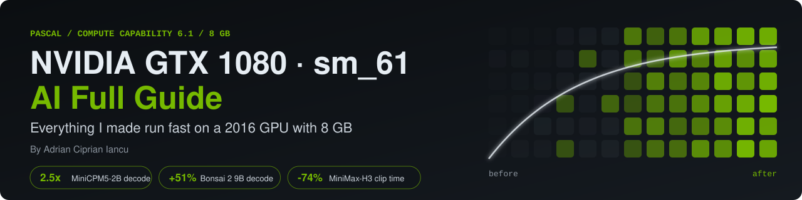
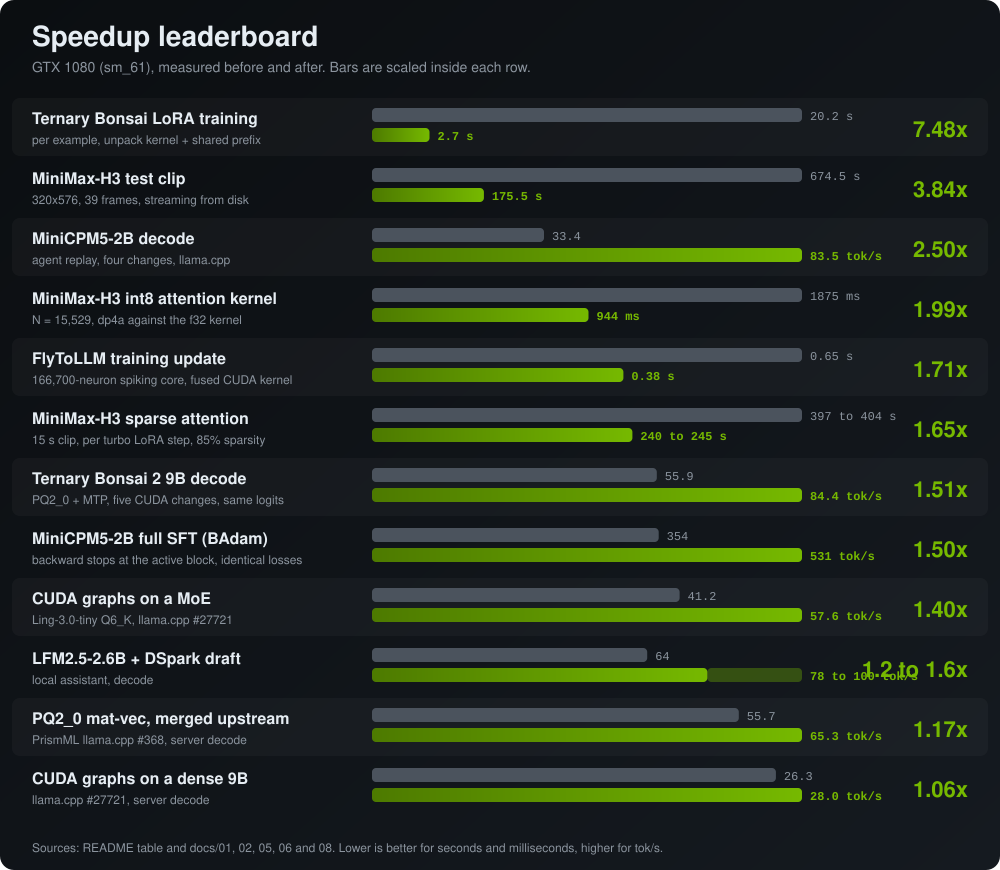
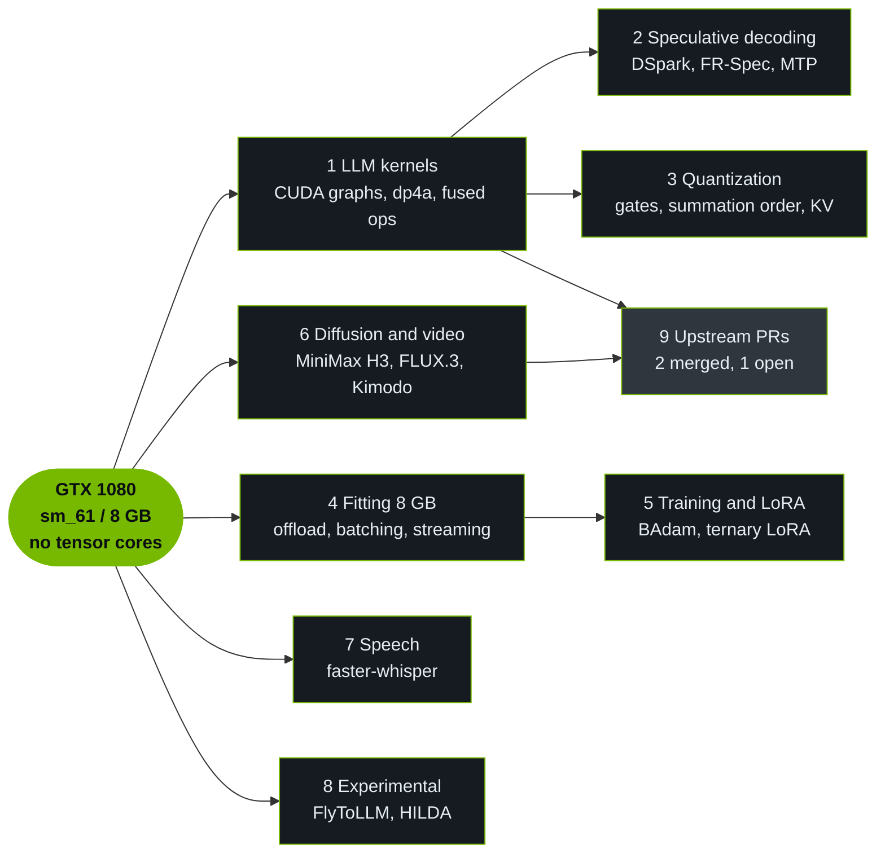

<p align="center">
  
</p>

# NVIDIA GTX 1080 (sm_61) AI Full Guide

By **Adrian Ciprian Iancu** · [GitHub](https://github.com/ArtyomITA) · [Hugging Face](https://huggingface.co/adriandj3) · [LinkedIn](https://www.linkedin.com/in/adrian-ciprian-iancu-a2a477391)

[](#the-card-and-what-its-limits-mean)
[](#the-card-and-what-its-limits-mean)
[](docs/04-fitting-8gb.md)
[](#the-card-and-what-its-limits-mean)
[](docs/01-llm-inference-kernels.md)
[](docs/06-diffusion-image-and-motion.md)
[](docs/09-upstream-contributions.md)
[](LICENSE)

Everything I measured, patched and trained to make current AI models run fast on one GeForce GTX 1080 (Pascal, compute capability 6.1, 8 GB), in one place and sorted by topic. Each entry says what the problem was, what I changed, what I measured, how to reproduce it, and where the code or the pull request lives.

I wrote it because the card is eight years old, still common, and mostly ignored by current toolchains: CUDA 13 drops Pascal, `torch==2.14` with CUDA 12.6 is the last PyTorch line with Pascal wheels, and most kernels assume tensor cores. Once you know where the time goes, the card runs today's small models, MoE models, video diffusion and speech at useful speed. Last updated 28 October 2026.

## TL;DR results

| What | Before → after | How |
|---|---|---|
| MiniCPM5-2B decode | 33 → **83.5 tok/s** (**2.5x**) | erase dead KV slots, bit-identical kernels, f16 KV, FR-Spec draft |
| Ternary Bonsai 2 9B decode | 55.9 → **84.4 tok/s** (**+51%**) | five CUDA changes, logits at the floor of the stock build |
| MoE decode (Ling-3.0-tiny) | 41.2 → **57.6 tok/s** (**+40%**) | CUDA graphs on sm_61, one line |
| Dense 9B decode | 26.3 → **28.0 tok/s** (**+6.4%**) | same one line |
| MiniMax-H3 video clip, 8 GB | 674.5 → **175.5 s** (**-74%**) | disk streaming with overlap, tile-group VAE, Q3 + turbo recipe |
| H3 attention kernel | 1875 → **944 ms** (**2.0x**) | int8 `dp4a` |
| H3 sparse attention, 15 s clip | 397 to 404 → **240 to 245 s** per turbo step (**1.65x**) | block-sparse port + conditioning prefix |
| Ternary LoRA training | 20.2 → **2.7 s** per example (**7.5x**) | unpack kernel, shared image prefix |
| 8B embeddings on 8 GB | 14,000 sentences in **3 h 16 min**, cosine **0.999956** | RAM offload + batching by exact length |
| Upstream | **2 merged**, **1 open** pull request | llama.cpp, PrismML fork, stable-diffusion.cpp |

<p align="center">
  
</p>

## Quick start

**1. MiniCPM5-2B at 83 tok/s** (numbers in the repo are from Linux, CUDA 12)

```bash
huggingface-cli download openbmb/MiniCPM5-2B-GGUF MiniCPM5-2B-Q8_0.gguf --local-dir .
huggingface-cli download adriandj3/MiniCPM5-2B-DSpark-FRSpec32k-GGUF MiniCPM5-DSpark-fr32k-Q8_0.gguf --local-dir .
# llama.cpp b2e5e9b28 + kernels/patches/pascal-sm61-kmcG-B02-B04.patch from minicpm5-kernel-pascal,
# built with -DCMAKE_CUDA_ARCHITECTURES=61
GGML_CUDA_DISABLE_GRAPHS=1 llama-server -m MiniCPM5-2B-Q8_0.gguf \
  -md MiniCPM5-DSpark-fr32k-Q8_0.gguf -ngld 999 \
  --spec-type draft-dspark --spec-draft-n-max 5 --spec-draft-n-min 0 \
  --cache-type-k f16 --cache-type-v f16 -c 49152 -b 2048 -ub 1024 -ngl 999 -fa on --jinja \
  --slot-save-path ./slots --temp 1.0 --top-p 0.95 --min-p 0.0
curl -X POST "http://127.0.0.1:8080/slots/0?action=erase"   # when a conversation ends
```

Recipe and every flag: [docs/01](docs/01-llm-inference-kernels.md), [docs/02](docs/02-speculative-decoding.md), [minicpm5-kernel-pascal](https://github.com/ArtyomITA/minicpm5-kernel-pascal).

**2. Ternary Bonsai 2 9B at 84 tok/s**

```bash
git clone https://github.com/PrismML-Eng/llama.cpp && cd llama.cpp && git checkout 0082ac24a
git apply /path/to/bonsai2-ternary-pascal/patches/0001-sm61-pq2_0-mtp-decode.patch
cmake -S . -B build -DGGML_CUDA=ON -DCMAKE_CUDA_ARCHITECTURES=61-real -DCMAKE_BUILD_TYPE=Release
cmake --build build --target llama-server -j
./build/bin/llama-server -m Ternary-Bonsai-2-9B-PQ2_0-MTP-Q8_0.gguf \
  --spec-type draft-mtp --spec-draft-n-max 2 --spec-draft-n-min 0 --spec-draft-p-min 0 \
  -c 16384 --parallel 1 -ngl 999 -fa on --jinja --reasoning off --cache-ram 0
```

The mat-vec piece alone (+17.3%) is already merged in the fork: [PrismML-Eng/llama.cpp#368](https://github.com/PrismML-Eng/llama.cpp/pull/368). Details: [docs/01](docs/01-llm-inference-kernels.md#12-ternary-bonsai-2-9b-51-decode-with-the-same-logits).

**3. CUDA graphs on any Pascal card** (one line, A/B in two commands)

```bash
# ggml/src/ggml-cuda/ggml-cuda.cu, ggml_cuda_graph_set_enabled:  GGML_CUDA_CC_VOLTA  ->  GGML_CUDA_CC_DP4A
GGML_CUDA_DISABLE_GRAPHS=1 ./build/bin/llama-bench -m model.gguf -r 3   # graphs off
./build/bin/llama-bench -m model.gguf -r 3                              # graphs on
```

Six models, perplexity identical, from +5.6% to +53.3%: [docs/01](docs/01-llm-inference-kernels.md#11-cuda-graphs-on-pascal-40-on-a-moe-7-on-a-dense-model), [llama.cpp#27721](https://github.com/ggml-org/llama.cpp/pull/27721).

**4. Training and LoRA on 8 GB**

```python
# full-parameter SFT with BAdam: 354 -> 531 tok/s, identical losses
model.gradient_checkpointing_enable(gradient_checkpointing_kwargs={"use_reentrant": False})
model.disable_input_require_grads()   # backward stops at the active block
```

A LoRA on a ternary 9B, trained on the card in 5.5 hours: the kit is in [lora-training](https://github.com/ArtyomITA/bonsai2-ternary-pascal/tree/master/lora-training), the walkthrough in [docs/05](docs/05-training-and-lora.md).

## Map of the guide



1. [LLM inference kernels in llama.cpp](docs/01-llm-inference-kernels.md): CUDA graphs, ternary mat-vec, MiniCPM5 kernels, f16 KV cache, dead KV slots, build flags.
2. [Speculative decoding on Pascal](docs/02-speculative-decoding.md): DSpark, FR-Spec, MTP, and when a draft pays.
3. [Quantization choices on sm_61](docs/03-quantization-on-sm61.md): why not FP16, which quantizations pass the quality gate, summation order, KV types.
4. [Fitting 8 GB](docs/04-fitting-8gb.md): offload without loss, lossless batching, large embeddings, disk streaming, memory traps on Windows.
5. [Training and LoRA on 8 GB](docs/05-training-and-lora.md): BAdam, fused cross-entropy, LoRA on ternary weights, calibrated decisions.
6. [Diffusion, image and motion](docs/06-diffusion-image-and-motion.md): stable-diffusion.cpp fix, WebGPU tiled VAE, Kimodo with LFM2.5, and the section **Video and image generation: MiniMax H3 on 8 GB**.
7. [Speech](docs/07-speech.md): faster-whisper.
8. [Experimental](docs/08-experimental.md): FlyToLLM, a spiking connectome language model; HILDA, a discrete diffusion LLM backend.
9. [Upstream contributions](docs/09-upstream-contributions.md): the three pull requests and their status.
10. [In progress / not yet published](docs/10-in-progress.md).

## The card, and what its limits mean

| Limit | What it means | Source |
|---|---|---|
| Compute capability 6.1 (sm_61) | Build for the card with `-DCMAKE_CUDA_ARCHITECTURES=61-real`. The default PTX build is slower and the binaries are much bigger. | [PASCAL-NOTES](https://github.com/ArtyomITA/minicpm5-kernel-pascal/blob/main/PASCAL-NOTES.md) |
| No tensor cores | Matrix work runs on fp32 FMA and on the int8 dot product `dp4a`. | [kernels/README](https://github.com/ArtyomITA/minicpm5-kernel-pascal/blob/main/kernels/README.md) |
| FP16 arithmetic at 1/64 of FP32 | fp16 is fine as a storage format and useless as a math format. Training runs in fp32. | [PASCAL-NOTES](https://github.com/ArtyomITA/minicpm5-kernel-pascal/blob/main/PASCAL-NOTES.md) |
| No native bf16, no Triton, no flash attention in PyTorch | bf16 is emulated. Attention kernels must be written or ported by hand. | [TRAINING-8GB](https://github.com/ArtyomITA/minicpm5-kernel-pascal/blob/main/TRAINING-8GB.md) |
| `dp4a` int8 available | ggml gates its int8 paths with `GGML_CUDA_CC_DP4A` (610). That is the hook for most of my kernels. | [llama.cpp#27721](https://github.com/ggml-org/llama.cpp/pull/27721) |
| 8 GB of VRAM | Models must be streamed, split in segments or offloaded. See [docs/04](docs/04-fitting-8gb.md). | |
| PCIe 3.0 x8 in my machine | Offloaded weights cost real time. | [PASCAL-NOTES](https://github.com/ArtyomITA/minicpm5-kernel-pascal/blob/main/PASCAL-NOTES.md) |
| Thermal throttling | After two to three minutes of load the card sits at 91 to 94 C and 1640 MHz instead of 1936 MHz. Compare builds only in the same thermal state. | [minicpm5-kernel-pascal](https://github.com/ArtyomITA/minicpm5-kernel-pascal) |
| Software support | CUDA 12.x toolkits for llama.cpp; `torch==2.14` with CUDA 12.6 is the last PyTorch line with Pascal wheels. | [PASCAL-NOTES](https://github.com/ArtyomITA/minicpm5-kernel-pascal/blob/main/PASCAL-NOTES.md) |

The single most useful fact about this card: at batch size one, decoding is bound by kernel launches, not by memory bandwidth. Almost every speedup in this guide follows from that, either by launching less (CUDA graphs, fused kernels) or by getting more tokens out of each launch (speculative decoding).

<p align="center">
  
</p>

## How I measure

- A/B runs alternate (A-B-B-A), the first run is dropped, the median is reported, and anything under 3% counts as noise.
- Kernel changes must be bit-identical, or pass a KL-divergence gate against the reference (`llama-perplexity --kl-divergence`) before I look at any speed number.
- Sampling seed fixed. Without it, two runs of the same build at temperature 1.0 differed by up to 10%.
- The GPU starts at or below 55 to 60 C, and the temperature is written next to the numbers.

## Full results table, with sources

<details>
<summary>Every headline number with its source (17 rows)</summary>

| Model | Task | Before to after | Technique | Source |
|---|---|---|---|---|
| MiniCPM5-2B Q8_0 | agent decode, llama.cpp | 33 to 83.5 tok/s (2.5x) | erase dead KV slots, bit-identical Q8 kernels, f16 KV cache, FR-Spec 32k draft | [minicpm5-kernel-pascal](https://github.com/ArtyomITA/minicpm5-kernel-pascal) |
| Ternary-Bonsai-2-9B (PQ2_0 + MTP) | decode, PrismML llama.cpp fork | 55.9 to 84.4 tok/s (+51%) | five CUDA changes, logits at the floor of the stock build | [bonsai2-ternary-pascal](https://github.com/ArtyomITA/bonsai2-ternary-pascal) |
| same model | decode, PQ2_0 mat-vec only | 55.7 to 65.3 tok/s (+17.3%) | exact-order mat-vec for 1 to 4 columns, merged upstream | [PrismML-Eng/llama.cpp#368](https://github.com/PrismML-Eng/llama.cpp/pull/368) |
| Ling-3.0-tiny Q6_K (MoE, 7.9B total, 1.3B active) | decode, llama.cpp | 41.2 to 57.6 tok/s (+39.8%); long generation 47.7 to 72.2 | CUDA graphs enabled on sm_61 | [llama.cpp#27721](https://github.com/ggml-org/llama.cpp/pull/27721) |
| dense Qwen-based 9B Q5_K_M | decode, llama.cpp | 26.3 to 28.0 tok/s (+6.4%) | CUDA graphs enabled on sm_61 | [llama.cpp#27721](https://github.com/ggml-org/llama.cpp/pull/27721) |
| LFM2.5-2.6B Q8_0 + DSpark draft | decode in my assistant | 64 tok/s, 78 to 100 with the draft | speculative decoding | [vergilius](https://github.com/ArtyomITA/vergilius) |
| MiniCPM5-2B + pjev LoRA | one-token decisions | 0.22 s median, 93.5% on 62 held-out decisions (71.0% without the LoRA) | LoRA extracted by truncated SVD | [HF card](https://huggingface.co/adriandj3/MiniCPM5-2B-pjev-LoRA) |
| MiniCPM5-2B | full-parameter SFT with BAdam | 354 to 531 tok/s, identical losses | stop backward at the active block | [TRAINING-8GB](https://github.com/ArtyomITA/minicpm5-kernel-pascal/blob/main/TRAINING-8GB.md) |
| Ternary-Bonsai-2-9B | LoRA training | 20.2 to 2.7 s per example | own unpack kernel, Hadamard as two 64x64 factors, shared image prefix | [lora-training](https://github.com/ArtyomITA/bonsai2-ternary-pascal/tree/master/lora-training) |
| Llama-3-8B (LLM2Vec) | embeddings on 8 GB | 14,000 sentences in 3 h 16 min, cosine 0.999956 vs the unbatched reference | RAM offload + batching by exact token length | [llm2vec-8gb-offload-lossless-batching](https://github.com/ArtyomITA/llm2vec-8gb-offload-lossless-batching) |
| LFM2.5-Embedding-350M for Kimodo | text-to-motion conditioning | 90 to 190 s down to 0.7 s per sentence | linear map 1024 to 4096 | [lfm-to-kimodo](https://github.com/ArtyomITA/lfm-to-kimodo) |
| Bonsai-Image 4B (WebGPU) | image generation at 512x512 | device lost, then about 35 s | tiled VAE decode | [bonsai-webgpu-tiled-vae-fix](https://github.com/ArtyomITA/bonsai-webgpu-tiled-vae-fix) |
| MiniMax-H3 (audio + video DiT) | 320x576, 39-frame clip, stable-diffusion.cpp | 674.5 to 175.5 s (-74%) | disk streaming with overlap, VAE in tile groups, Q3 + turbo recipe | [docs/06](docs/06-diffusion-image-and-motion.md#64-video-and-image-generation-minimax-h3-on-8-gb) |
| MiniMax-H3 | attention kernel | 1875 to 944 ms at N=15529 (2.0x) | int8 `dp4a` attention (code release pending) | [docs/06](docs/06-diffusion-image-and-motion.md#645-8-bit-attention-for-the-diffusion-transformer-code-release-pending) |
| MiniMax-H3 | sparse attention, 15 s clip | 397-404 to 240-245 s per turbo step (1.65x) | block-sparse port + conditioning prefix (code release pending) | [docs/06](docs/06-diffusion-image-and-motion.md#646-sparse-attention-and-the-conditioning-prefix-code-release-pending) |
| FLUX.3 Image Klein Q8 | 768x1344, 16 steps | out of memory, then 288.7 s sampling | graph cuts, 44 segments (code release pending) | [docs/06](docs/06-diffusion-image-and-motion.md#648-flux3-image-klein-on-8-gb-code-release-pending) |
| FlyToLLM (166,700-neuron spiking LM) | training update | 0.65 to 0.38 s | CUDA Graph FP32 + fused gather-accumulate kernel | [flytollm](https://github.com/ArtyomITA/flytollm) |

</details>

## Reproducing and citing

Every entry links to the repository, model card or pull request that holds the code, the patch or the raw numbers. Commands in this guide are short on purpose; the repositories have the full recipes. The charts are generated by [`tools/make_charts.py`](tools/make_charts.py) (standard library only): `python tools/make_charts.py`.

```bibtex
@misc{iancu2026gtx1080guide,
  author       = {Iancu, Adrian Ciprian},
  title        = {NVIDIA GTX 1080 (sm_61) AI Full Guide},
  year         = {2026},
  howpublished = {\url{https://github.com/ArtyomITA/nvidia-gtx1080-sm61-ai-full-guide}}
}
```

## License

Text and figures: CC BY 4.0. Code snippets: MIT. See [LICENSE](LICENSE). I am not affiliated with OpenBMB, PrismML, MiniMax, Black Forest Labs, Liquid AI, inclusionAI, the llama.cpp authors or the stable-diffusion.cpp authors; model and project names belong to their owners. No clips, frames or photos generated by MiniMax-H3 appear in this repository.

Keywords: GTX 1080, Pascal, sm_61, compute capability 6.1, llama.cpp, CUDA graphs, dp4a, int8, ternary, MoE, speculative decoding, DSpark, FR-Spec, MTP, LoRA, BAdam, stable-diffusion.cpp, MiniMax-H3, FLUX.3 Klein, WebGPU, faster-whisper, 8 GB VRAM, local LLM, older NVIDIA GPUs
