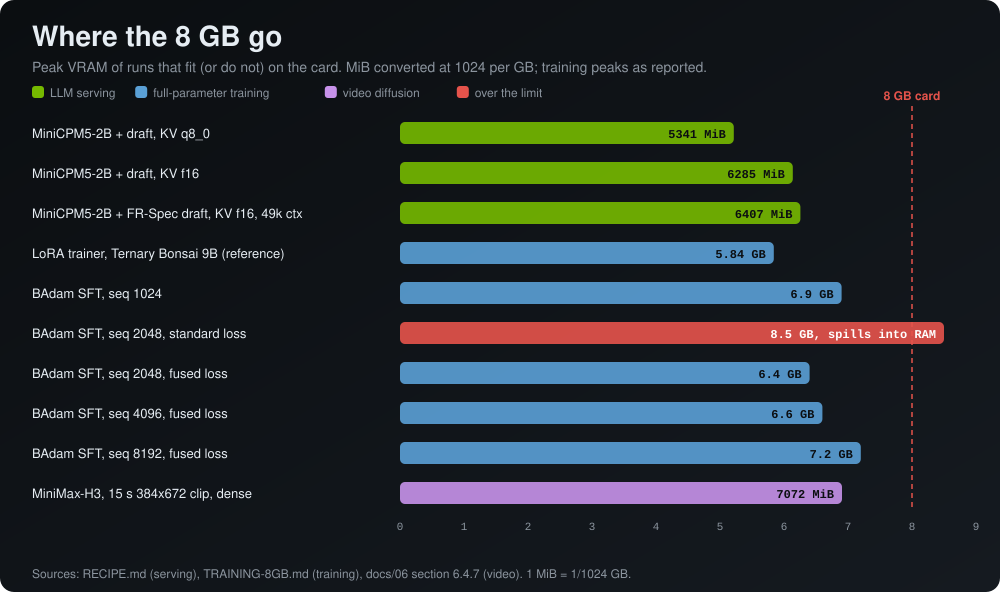

# 4. Fitting 8 GB

By **Adrian Ciprian Iancu** · [GitHub](https://github.com/ArtyomITA) · [Hugging Face](https://huggingface.co/adriandj3) · [LinkedIn](https://www.linkedin.com/in/adrian-ciprian-iancu-a2a477391)

Back to the [guide](../README.md).

## 4.1 An 8B encoder on an 8 GB card, with the same embeddings

**Problem.** LLM2Vec on Meta-Llama-3-8B-Instruct is about 15 GB in bfloat16. An 8 GB card cannot load it, and ordinary batching pads every sentence to the longest in the batch, which changes the pooled embedding.

**What I did.** Two small patches for [LLM2Vec](https://github.com/McGill-NLP/llm2vec):

1. Keep the weights in system RAM and stream each module to the GPU for its forward pass with `accelerate.cpu_offload`, so peak VRAM is roughly one layer. The line `model.to = lambda *a, **k: model` is not optional: `LLM2Vec.encode` calls `self.to(device)` and on offloaded meta tensors that raises `NotImplementedError: Cannot copy out of meta tensor`.
2. Batch by exact token length, so no padding is ever inserted. Length is measured after LLM2Vec's own prompt wrapper, otherwise two sentences that tokenize alike raw land in different buckets once the instruction template is prepended.

**Result.** GTX 1080 8 GB, Ryzen 3 4300GE, 16 GB RAM:

| Variant | cosine vs reference | speed |
|---|---|---|
| one sentence at a time, no batching (reference) | 1.000000 | |
| offload alone, one sentence at a time | 0.999962 | |
| **bucketed batching, batch 64** | **0.999956** | **0.73 s per sentence** |
| padded batching, batch 64 | 0.76 | |

The padded row is the point: it is fast, it looks like it works, and the vectors are simply not the same vectors. End to end, 14,000 sentences went through the 8B encoder in 3 h 16 min with the embeddings still matching the unbatched reference.

**Two things that will bite you.** Always pass `device=` to `encode` (left alone it auto-selects CUDA and pulls the offloaded weights onto the card). And check a few batched vectors against unbatched ones before trusting a whole run.

**Reproduce.** `python verify.py --base /models/Meta-Llama-3-8B-Instruct`. Code and numbers: [llm2vec-8gb-offload-lossless-batching](https://github.com/ArtyomITA/llm2vec-8gb-offload-lossless-batching).

## 4.2 Replacing the big encoder altogether

The same pipeline fed a text-to-motion model that expected LLM2Vec vectors (15 GB of weights, 90 to 190 s per sentence). I replaced the encoder with a 350M embedding model plus a linear map and got 0.7 s per sentence. See [docs/06](06-diffusion-image-and-motion.md#63-kimodo-text-to-motion-with-lfm25-instead-of-llama-3-8b).

## 4.3 VRAM budget of a speculative LLM server

MiniCPM5-2B Q8_0 with a draft at 49k context (measured peak):

| Configuration | peak VRAM |
|---|---|
| KV q8_0, official draft | 5341 MiB |
| KV f16, official draft | 6285 MiB |
| **KV f16, FR-Spec draft (my recipe)** | **6407 MiB** |

`-c 32768` frees about 0.7 GB with the f16 cache. The FR-Spec head is a separate copy (+122 MiB). Source: [RECIPE.md](https://github.com/ArtyomITA/minicpm5-kernel-pascal/blob/main/RECIPE.md).

## 4.4 Models far bigger than the card: segments and disk streaming

A video model whose weights are 25 GB in total runs on this card because stable-diffusion.cpp cuts the graph in segments and loads each segment's weights just before it runs (`--params-backend disk --max-vram cuda0=6`). Making that fast is its own topic: reading the next segment in a thread while the GPU computes the current one took a test clip from 674.5 s to 175.5 s. See [docs/06](06-diffusion-image-and-motion.md#64-video-and-image-generation-minimax-h3-on-8-gb).

## 4.5 Peak memory in training

On a 130,560-token vocabulary the logits are the memory problem: at 2048 tokens the standard loss peaks at 8.5 GB and spills into system RAM. A fused cross-entropy that never builds the full logits brings it to 6.4 GB. Table in [docs/05](05-training-and-lora.md).

## 4.6 Tiled decode when an operator does not fit

Bonsai-Image (WebGPU) on a GPU without `shader-f16` crashes at the VAE above 256x256 because the float32 conv2d buffers double. Decoding the latent in overlapping tiles, each in its own GPU scope, fixed it: 512x512 in about 35 s. See [docs/06](06-diffusion-image-and-motion.md#62-webgpu-tiled-vae-for-gpus-without-shader-f16).

## 4.7 Windows-specific memory traps

- **Shared GPU memory.** With 8 GB, PyTorch training that fragments memory spills into system RAM and runs twice as slow (I saw 800 MB of "shared" GPU memory). One `torch.cuda.empty_cache()` per optimizer step fixed it. `torch.cuda.set_per_process_memory_fraction(0.97)` makes a run fail with out of memory instead of silently spilling (a value of 1.0 caps nothing).
- **Hardware-accelerated GPU scheduling** costs +514 MiB of VRAM for no gain in my tests.
- **Page cache and RAM.** When weights stream from disk, free RAM changes timings a lot: in one run only 2.9 GB of RAM was free and 5.4 GB of DiT weights were re-read from disk. Load big weights memory-mapped read-only, and evict the page cache before a timing run.
