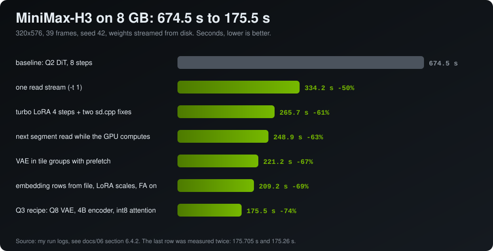

# 6. Diffusion, image and motion

By **Adrian Ciprian Iancu** · [GitHub](https://github.com/ArtyomITA) · [Hugging Face](https://huggingface.co/adriandj3) · [LinkedIn](https://www.linkedin.com/in/adrian-ciprian-iancu-a2a477391)

Back to the [guide](../README.md).

- [6.1 The LoRA alpha fix (merged)](#61-the-lora-alpha-fix-merged)
- [6.2 WebGPU tiled VAE for GPUs without shader-f16](#62-webgpu-tiled-vae-for-gpus-without-shader-f16)
- [6.3 Kimodo text-to-motion with LFM2.5 instead of Llama-3-8B](#63-kimodo-text-to-motion-with-lfm25-instead-of-llama-3-8b)
- [6.4 Video and image generation: MiniMax H3 on 8 GB](#64-video-and-image-generation-minimax-h3-on-8-gb)

## 6.1 The LoRA alpha fix (merged)

**Problem.** Since stable-diffusion.cpp #2159 the LoRA loader uses the file-level `alpha` metadata when a tensor has no alpha or scale of its own. Some converted MiniMax-H3 LoRAs store both `alpha` and `baked_scale` in the metadata: the converter has already folded alpha / rank into `lora_B` and kept the original `alpha` only as a note. stable-diffusion.cpp then applied alpha / rank a second time.

**How I found it.** `minimax_h3_ref2v_lightx2v_turbo_4step_v0.1_resized_avg_rank_20_bf16.safetensors` from [Kijai/MiniMax-H3_comfy](https://huggingface.co/Kijai/MiniMax-H3_comfy) has `alpha = 8`, `baked_scale = 0.0625`, no `.alpha` tensors and ranks from 2 to 164 (the file is rank-resized). Every layer got an extra factor of 8 / rank, anywhere between 0.05 and 4, and the video came out smeared with a ghosted face, with no clean frame in the clip. Two other files in the same repository carry both keys (alpha 128 and alpha 8).

**The fix.** Skip the metadata alpha only when `baked_scale` is present. LoRAs without `baked_scale` behave exactly as before. Timing is identical with and without the fix (sampling 180.7 s against 181.5 s).

**Test setup.** Windows 11, GTX 1080 8 GB, CUDA 12.4, MiniMax-H3 Ref2VA Q3_K, Qwen3-VL-32B Q2_K_M text encoder, fp16 VAE, 320x576, 39 frames, seed 42, `--steps 4 --scheduler simple --cfg-scale 1 --params-backend disk --max-vram cuda0=6 -t 1`, LoRA at 1.0.

**Status.** [leejet/stable-diffusion.cpp#2202](https://github.com/leejet/stable-diffusion.cpp/pull/2202), merged on 24 October 2026.

## 6.2 WebGPU tiled VAE for GPUs without shader-f16

**Problem.** [Bonsai-Image 4B](https://huggingface.co/collections/prism-ml/bonsai-image) by PrismML is a 1-bit / ternary diffusion model that runs entirely in the browser through WebGPU. On GPUs without the `shader-f16` feature (NVIDIA Pascal and older), the runtime falls back to float32 end to end, and any generation above 256x256 crashes in the VAE decode: Chrome loses the device (`GPUPipelineError: A valid external Instance reference no longer exists.`), Firefox reports `Not enough memory left` on a `conv-out-conv2d_128_128_512_512_3_1_b_float32...` buffer. It is not the TDR timeout and not VRAM totals: I reproduced it with `TdrDelay=60` and 7.5 GB free, on both Dawn backends and on wgpu.

**What I did.** Decode the latent in overlapping tiles (latent tile of 32 px plus 8 overlap, image tiles up to 384x384), each in its own GPU scope so memory is released between tiles, and stitch on the CPU with a feathered blend. It activates only when `!caps().f16 && (latentH > 40 || latentW > 40)`, so devices with f16 keep the original path and their output is unchanged. About 1.4 KB of JavaScript at the VAE call site, no WGSL changes, no new kernels.

**Result.** GTX 1080, driver 582.28, Windows 11, Chromium with `--enable-unsafe-webgpu`, Bonsai-Image 1-bit, 4 steps, weights from a local mirror:

| Resolution | Stock runtime | With the patch | VAE tiles |
|---|---|---|---|
| 256x256 | about 15 s | about 15 s (patch inactive) | 1 |
| 512x512 | device lost at the VAE | **about 35 s**, no visible seams | 4 |
| 768x768 | fails | **about 100 s** (96.4 s on the Space's own readout) | 9 |

**Reproduce.** The web runtime ships minified in the Space bundle, so the patch is applied by string replacement: `node patch-bundle.js path/to/index-XXXX.js path/to/output.js`, then serve the directory with a static server that supports Range requests. Code: [bonsai-webgpu-tiled-vae-fix](https://github.com/ArtyomITA/bonsai-webgpu-tiled-vae-fix). Credit for the model and the runtime goes to the PrismML team; the proper fix belongs in the runtime itself.

## 6.3 Kimodo text-to-motion with LFM2.5 instead of Llama-3-8B

**Problem.** NVIDIA Kimodo generates human motion but does not read text: it expects a vector from LLM2Vec on Meta-Llama-3-8B, which is 15 GB of weights and 90 to 190 s per sentence, only to condition the motion model.

**What I did.** Replace that encoder with LFM2.5-Embedding-350M (700 MB) plus a linear map that translates its 1024 numbers into the 4096 Kimodo expects: a ridge regression (lambda 1e-4) trained on 14 thousand embedding pairs, LFM on one side, LLM2Vec-Llama-3-8B on the other, same sentence. Forward: centre with `mu_x`, L2-normalise, multiply by `W`, L2-normalise, rescale to the mean norm, add `mu_y`; both normalisations are needed because Kimodo is sensitive to the norm of the vector, not only its direction. A 4-layer SELU MLP lost (0.726 against 0.815).

The 14 thousand training pairs exist because of the 8 GB offload and lossless batching work in [docs/04](04-fitting-8gb.md).

**Result.**

| | original | this map |
|---|---|---|
| encoder | Llama-3-8B, 15 GB | LFM2.5, 700 MB |
| time per sentence | 90 to 190 s | **0.7 s** |
| cosine, English test | reference | 0.815 |
| right sentence at first try, English | reference | 97.8% |
| cosine, Italian test (cross: Italian sentence, English reference) | reference | 0.701 |
| right sentence at first try, Italian | reference | 93.0% |

After the first load, generation takes about 7 s for 3 s of animation, almost all of it in the diffusion. The kind of motion arrives; fine details such as which hand or which side sometimes drift. Output: `.npz` in the Kimodo format (77 joints, 30 fps), `.bvh` for Blender or Unity, and an optional preview `.gif`.

The weights are on Hugging Face: [LFM2.5-to-Llama8B-LLM2Vec-Kimodo](https://huggingface.co/adriandj3/LFM2.5-to-Llama8B-LLM2Vec-Kimodo). The v2 package there trains on 40,232 eligible pairs (39,063 English and 1,169 Italian) with a ridge plus RBF residual and reports centred cosine 0.852584 on the English test (999 rows) and 0.729607 on the Italian test (200 rows); its card says the v1 figures above use an earlier protocol and should not be compared directly.

**Unity traps that cost hours.** Pass `global_rots_to_local_rots(global_rot_mats, somaskel77)` to an external rig instead of the `.npz` local rotations, and take the root from `posed_joints[:, root_idx, :]`; do not leave the skeleton root at y = 0 (Unity computes a `humanScale` of about 0.009 and the character sinks underground; raise it to the hip height, about 1 m); when the pose comes from `SetHumanPose` outside the Animator loop, set `updateWhenOffscreen = true` and `forceMatrixRecalculationPerRender = true`.

**Reproduce.** [lfm-to-kimodo](https://github.com/ArtyomITA/lfm-to-kimodo): run `python lfm_server.py` with `LFM_MODEL` set, then `python genera.py "a person waves hello with the right hand" --durata 3 --gif`.

## 6.4 Video and image generation: MiniMax H3 on 8 GB

**Scope.** [MiniMax-H3](https://huggingface.co/MiniMaxAI/MiniMax-H3) is a joint audio and video diffusion transformer: you give it a prompt (and optionally a reference image or a first frame) and it returns a clip with synchronised speech. I run it on the GTX 1080 with [stable-diffusion.cpp](https://github.com/leejet/stable-diffusion.cpp). This section is text and numbers only. There are no clips, frames or photos from the model here: its license does not cover showing its outputs from the EU, where I live.



### 6.4.1 What runs, and how

- Files: the GGUF of the pruned Ref2VA DiT ([leejet/MiniMax-H3-GGUF](https://huggingface.co/leejet/MiniMax-H3-GGUF), Q2_K_M 6.72 GB; later Q3_K 8.72 GB), the Qwen3-VL-32B text encoder (Q2_K_M, 13.1 GB), the video VAE in fp16 (5.21 GB) and the audio VAE in fp32 (0.61 GB) from [Comfy-Org/MiniMax-H3](https://huggingface.co/Comfy-Org/MiniMax-H3). About 25 GB in total, on a card with 8 GB.
- Machine: GTX 1080 8 GB, 14.9 GB of RAM, Ryzen 3 4300GE, Windows 11, CUDA 12.4. The models live on an HDD.
- How it fits: stable-diffusion.cpp cuts the transformer into segments (54 in the short-clip setup) and loads each segment's weights from disk just before it runs: `--params-backend disk --max-vram cuda0=6`.
- Command shape (prompt through a file, because a quoted prompt passed with `-p` from Windows PowerShell 5.1 splits):

```bash
sd-cli -M vid_gen --cfg-scale 1.0 --rng cpu --params-backend disk --max-vram cuda0=6 \
       --vae-tiling --steps 4 --scheduler simple -t 1 --prompt-file prompt.txt ...
```

- First runs, Q2 DiT: 288x512, 22 frames, 4 steps in 9.3 min (7.5 GB VRAM); 480x864, 4.4 s, 20 steps in 1 h 43 min with a face that came out like a ghost.
- Found on commit 0518b34 and handled in my build: the tokenizer lacked the `<d>` and `</d>` tokens (ids 151669 to 151675), and the discrete scheduler had a wrong last step, so I use `--scheduler simple`.

### 6.4.2 Speed: 674.5 s to 175.5 s (-74%)

Test clip: 320x576, 39 frames (1.6 s), seed 42, the official prompt with a short Italian sentence, page cache evicted before every measurement. The weights stream from an HDD, and the loader already reads at the physical limit of that disk (about 155 MB/s, roughly 166 s of I/O per run). So the gains come from reading fewer bytes or from overlapping the read with the compute.

| Step | Seconds | vs baseline | What changed |
|---|---|---|---|
| baseline: Q2 DiT, 8 steps | 674.5 | | stock stable-diffusion.cpp (commit 0518b34) |
| one read stream (`-t 1`) | 334.2 | -50% | a single reader on the HDD instead of several threads |
| turbo LoRA in 4 steps + two sd.cpp fixes | 265.7 | -61% | LoRA `alpha` fix ([6.1](#61-the-lora-alpha-fix-merged)); no fixed 200 ms wait at the end of `load_tensors` |
| next segment read in a thread while the GPU computes | 248.9 | -63% | output bit-identical |
| VAE decoder run block by block over groups of 12 tiles, next block read under the compute | 221.2 | -67% | output bit-identical |
| embedding rows read from the file (the 1.5 GB table is never loaded), LoRA without useless scales, flash attention forced on | 209.2 | -69% | same image |
| **combined Q3 recipe**: DiT Q3_K + turbo 4 steps, VAE Q8, 4B text encoder with an MLP projection, 8-bit attention ([6.4.5](#645-8-bit-attention-for-the-diffusion-transformer-code-release-pending)), a weight cache file on the SSD | **175.5** | **-74%** | not bit-identical; speech perfect and face photoreal on 4 seeds |

The last row was measured twice (175.705 s and 175.26 s). With the 4B encoder and the learned projection, encoding takes 36 s instead of 67 s; the Q8 VAE decodes in 24.0 s instead of 34.9 s at a PSNR of 42.6 dB.

Things I tried and dropped on the way:

- VAE decoded in a single tile: 10 s faster but a grid of artifacts, because the VAE is trained on 16x16-latent tiles.
- A small replacement VAE (`taeh3`): blurred, streaked face.
- The encoder's `ffn_down` tensors at Q3: broken speech and a doubled face.
- A plain linear map from the 4B encoder to the 32B embedding space: doubled face (the MLP map fixed it).
- Retuning the Q2_K matrix-matrix tile width: no bit-identical gain; the kernel is bound by instruction issue.

### 6.4.3 Streaming pull request, measured on current upstream

The first two changes of the chain (no idle wait at the end of `load_tensors`; read the next disk-resident segment on a worker thread) are prepared as a pull request for stable-diffusion.cpp. Measured on upstream 95ff762 (a clean build, page cache flushed before every run, two runs per variant, alternated, frames bit-identical to master in every run), 320x576, 39 frames, 4 steps, Q3_K + turbo LoRA, 32B encoder Q2_K_M:

| Variant | steps 2 to 4 | sampling | total |
|---|---|---|---|
| master | 30.1 s per step | 181.5 / 183.3 s | 326.6 s |
| `load_tensors` wait removed only | 21.2 s per step | 143.1 / 144.3 s | 282.5 / 284.6 s |
| background segment load only | 23.2 s per step | 145.0 s | 289.2 s |
| both | **15.9 s per step** | **112.3 / 112.2 s** | **250.7 / 251.0 s** |

Sampling -38%, whole run -23%. The first step reads everything from a cold cache, so it gains less and is noisier when something else uses the disk. Merging LoRAs at load time is excluded from the background path (merging runs graphs on the compute backend, which has to stay on the main thread); with disk params the default LoRA mode is applied at runtime, so the common case is covered. Status: ready locally, not opened yet.

### 6.4.4 Quality: what made it look right on this card

- **The ghost face was the uniform Q2 DiT.** DiT Q3_K + the 4-step turbo LoRA gave a photoreal, stable face even at 124 frames (5.2 s, 320x576), word error rate 0, in 562.7 s.
- **Resolution and prompt are the two biggest jumps.** 544x960 (the resolution the turbo LoRA was trained at) and a long prompt in the official format.
- **The plastic look comes from the distillation.** With no LoRA at 12 steps (753 s) the skin and hair were the most natural. A hybrid fixes most of it: turbo LoRA for the first 4 steps, then 2 base-model steps (`H3_LORA_PASSI=4`, sigmas 1, 0.972973, 0.923077, 0.8, 0.55, 0.3, 0), 412 s at 544x960 with 39 frames. The two best recipes use the hybrid plus a prompt that asks for a matte forehead, with either a realism LoRA at 0.7 or a second community LoRA; both take about 413 s. A faster recipe with a 4-step distilled LoRA takes 324 s.
- **One more step after the four LoRA levels**, at sigma 0.4 (`--sigmas 1,0.972973,0.923077,0.8,0.4,0`), made the knit of a sweater much sharper.
- **From a first-frame photo (FL2VA)**, 544x960 and 90 frames (3.75 s): 1192 s with the Q3_K DiT, 1324 s with Q6_K, peak VRAM 7130 and 7088 MiB. Hands and the text on a cap stay stable.
- **The pipeline is chaotic.** A change at the level of float rounding in the attention changes the video: PSNR between runs 24 to 28 dB. With the same seed and different attention kernels the PSNR is 30 to 33 dB, with different seeds 18 to 19 dB. So an idea that is not bit-identical has to be judged on at least four seeds and by eye; a fixed-seed sharpness metric does not discriminate. Over seeds 1, 2 and 3 the face sharpness was 161.7 (f32 attention), 165.1 (one-limb int8) and 173.7 (two-limb int8), and the word error rate 0.11, 0 and 0.

### 6.4.5 8-bit attention for the diffusion transformer (code release pending)

**Problem.** In the profile of a 480x864, 124-frame step, attention is 57% of the time and quantized compute 32%.

**What I did.** A CUDA attention kernel for the DiT shapes (d = 128, 56 heads, f32 queries, f16 K and V, no mask): K is centred per channel (as the smooth-K of the sparse-attention work does), scaled to int8 per token and head, QK^T runs on `dp4a`, the softmax is online in fp32 and PV runs in fp32 with V in f16. The one-limb version uses a single int8 limb for Q and K; the two-limb version adds a second limb for accuracy.

**Result.**

| | f32 reference | one limb | two limbs |
|---|---|---|---|
| kernel, N = 15,529 | 1875 ms | **944 ms (2.0x)** | 1529 ms (1.2x) |
| kernel, N = 4096 | 125 ms | 65 ms | 115 ms |
| attention in one step at 480x864x124 | 107.7 s | 52.2 s | |
| whole step at 480x864x124 | 194.3 / 191.2 s | **138.7 / 134.0 s (-30%)** | |
| smoke clip sampling | 101.3 s | 97.0 s | |

Peak VRAM goes from 6565 to 6541 MB and the compute buffer is unchanged at 4370.5 MB. The error on live tensors (200 calls): mean relative L2 of 3e-5 to 7e-5 for two limbs and about 6e-3 on most heads for one limb. About 1% of the heads are outliers (huge logits from one large K channel): there the one-limb error reaches 4 to 8% and the two-limb error 3.5e-3. On several seeds and by eye I saw no difference from f32 attention. It is not bit-identical, so it is judged as in [6.4.4](#644-quality-what-made-it-look-right-on-this-card). Status: **code release pending**.

### 6.4.6 Sparse attention and the conditioning prefix (code release pending)

**Problem.** The LightX2V "Turbo-SLA" LoRA for MiniMax-H3 is meant to be used with dynamic sparse attention: mean-pool Q in blocks, score the (centred) K blocks, keep the top 15% of K blocks per Q block, and run exact attention only on those. For a 15 s clip the attention is about half of the compute.

**What I did.** I ported that algorithm into the int8 kernel above (Q blocks of 128, K blocks of 64, skip the unselected KV blocks inside the kernel; off in the base-model steps). Checks: with sparsity off the latent is bit-identical to the dense kernel; the block map equals the Python reference on 100% of the rows (N = 748 and N = 2838); the kernel output against exactly masked attention has a mean relative error of 4.9e-3, the one-limb error.

**Result at 15 s.** 384x672, 362 frames (N = 29,170 tokens), Q6_K DiT, 4 turbo steps with the SLA LoRA plus the base-model steps, same seed:

| | dense | sparse (85%) |
|---|---|---|
| total | 3000 s | **2364 s (-21%)** |
| sampling | 2370 s | 1732 s (x1.37) |
| each turbo (LoRA) step | 397 to 404 s | **240 to 245 s (x1.65)** |
| peak VRAM | 7072 MB | 7035 MB |
| speech heard by Whisper (word error rate) | "Ci vediamo al traguardo!" (0.2) | "Musica" (1.0) |

**The finding.** Pure sparse attention lost the speech. On a dump of the attention (N = 2838), 59% of the (head, video block) pairs saw none of the text blocks and 59% none of the blocks of the first image, and the audio tokens have no query blocks of their own. In a joint audio and video transformer the top-k by average similarity leaves out the conditioning. The fix is a conditioning prefix that is always visible (the idea behind the anchors of Mixture of Contexts): `H3_SLA_COND=1` keeps the K blocks of the start of the sequence for every query block and computes the prefix query blocks in full. On the same dump, 0% of the pairs are left without text or first image. With the prefix:

| Clip | Sparse + prefix | Pure sparse | Dense |
|---|---|---|---|
| 544x960, 56 frames, word error rate | **0** | | 0 |
| 384x672, 56 frames, word error rate | 0.2 | 1.0 ("Aaaa") | |

At 544x960 and 56 frames the sparse sampling takes 471 s against 478 s dense: at that length there is nothing to skip, and the speed gain shows up with long clips (the 1.65x above). The distorted nose in the 15 s clip came from the 384x672 resolution (the dense 15 s clip has it too). Status: **code release pending**.

### 6.4.7 Long clips on 8 GB

- A 15 s clip at 384x672 and 362 frames is N = 29,170 tokens. The first attempt failed in 3.5 s: one segment needed 7722 MB against a budget of 7226 MB. Cutting the graph before the flash attention and computing qkv, norm and rope in 8 pieces copied into a buffer (`H3_TAGLIO_ATTN=2`, `H3_MLP_PEZZI=8`), plus a one-limb int8 K and Q, brought the dense run to 7072 MB at 3000 s.
- A 15 s clip at 544x960 in one piece does not fit: the qkv segment needs 8799 MB even with 16 pieces.
- What works at 544x960 is a chain: five clips of 90 frames, each continuing from the saved latent of the previous one (a motion-context tail of 22 frames, which is 7 latent steps, with one anchor per step), the idea taken from a ComfyUI node and rewritten. The seam is not visible by eye, and the PSNR at the seam equals that between neighbouring frames. Status: code release pending.

### 6.4.8 FLUX.3 Image Klein on 8 GB (code release pending)

**Problem.** I make the first frame of a clip with [FLUX.3 Image Klein](https://huggingface.co/black-forest-labs/flux-3-image-klein) Q8_0 (6.2 GB) in stable-diffusion.cpp, with a reference photo and a Qwen3-VL-4B text encoder. At 768x1344 the graph asks for 8022 MB in a single segment and fails on the 1080 (6.6 GB free).

**What I did.** Two `mark_graph_cut` calls in `src/model/diffusion/flux3.hpp`, one after every double-stream block and one after every single-stream block. That gives 44 segments and a compute buffer of 1665 MB at the peak, and the image comes out clean.

**Result.** 768x1344, 16 steps, Euler, CFG 1.0: **288.7 s of sampling**, 340.7 s for the whole generation. Current upstream (95ff762) has no such cuts. Status: **code release pending**, a small pull request for anyone with an 8 GB card.

### 6.4.9 Where the code stands

| Piece | Status |
|---|---|
| LoRA `baked_scale` fix | merged, [stable-diffusion.cpp#2202](https://github.com/leejet/stable-diffusion.cpp/pull/2202) |
| disk streaming speed-up (load wait + background segment load) | ready locally, pull request not opened |
| int8 `dp4a` attention kernel | code release pending |
| sparse attention port + conditioning prefix | code release pending |
| FLUX.3 graph cuts | code release pending |
| motion-context chain for long clips | code release pending |
| weight cache file on SSD (Windows only) | not planned for upstream |
